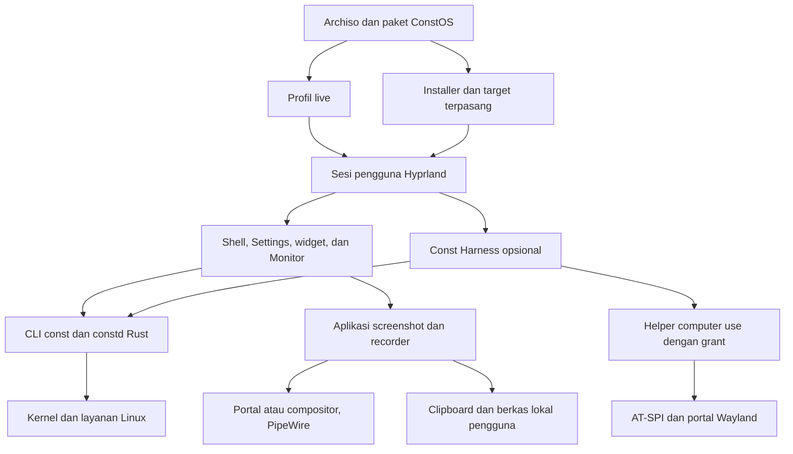

# Arsitektur ConstOS

ConstOS menargetkan desktop x86_64 UEFI berbasis CachyOS dengan Hyprland/Wayland. Desktop, installer, capture, dan diagnosis harus dapat digunakan tanpa akun AI, Harness, atau model lokal. Dukungan perangkat ditetapkan dari pengujian, bukan dari daftar paket.

Dokumen ini menjelaskan batas komponen dan arah desain. Status serta bukti penerimaan ada di [roadmap](../implementation_plan.md); cara membangun profil live ada di [panduan build](build-guide.md). Perubahan dokumentasi mengikuti [AGENTS.md](../AGENTS.md).

## Implementasi saat ini dan target

| Area | Implementasi saat ini | Target dan batas |
| --- | --- | --- |
| Build dan boot | Profil Archiso di `iso/`, kernel CachyOS BORE, tema GRUB/Plymouth/SDDM, dan `iso/install-boot.sh`. Roadmap mencatat bukti build baseline serta verifikasi integrasi terbaru. | CI Linux, pembuktian seluruh skenario Boot UI di VM baru, dan bukti perangkat fisik. BIOS, Secure Boot, dan varian kernel/CPU bukan dukungan implisit. |
| Desktop live | `desktop/install.sh` memasang sesi `constos.desktop` → `constos-session`, Lua Hyprland, unit user `constos-session.target`, tema fallback, portal, MIME, dan override GSettings. | Shell/Settings Quickshell/QML masih perlu spike fokus, multi-monitor, aksesibilitas, dan performa. Fallback tetap tersedia selama cutover. |
| Screenshot dan media | `constos-screenshot` dipakai oleh Print, Alt+Print, launcher, dan Waybar; seleksi dibatalkan tanpa menimpa clipboard. | Pembuktian pada sesi live/installed penuh, lalu UI screenshot, editor anotasi, recorder video, dan recorder audio di fase 07A. |
| Sistem dan storage | Konfigurasi ZRAM/sysctl, paket `constos-core`/`constos-desktop`, serta launcher/backend Calamares untuk disk UEFI kosong. Pembuktian instalasi Btrfs, reboot tanpa ISO, dan login akun baru di SDDM telah lulus di VM. | Uji recovery/rollback Snapper dari bootloader dan verifikasi perangkat fisik sebelum ConstOS 1.0. |
| Telemetri | CLI Rust `const` dari `constos-core` membaca data sistem pada target terpasang. Profil live masih memuat prototipe Python `constd` HTTP GET/JSON. | Satu collector Rust bersama dan IPC sesi bertipe. HTTP lama dihapus ketika konsumen sudah bermigrasi. |
| Harness dan sandbox | Resep paket Harness dan wrapper Bubblewrap tersedia. | Paket Linux lengkap, helper computer use sesi pengguna, izin per capability, dan sandbox teruji. Keberadaan wrapper bukan bukti seluruh workspace/desktop sudah terisolasi. |
| Aset | Master simbol Const di `assets/const-logo.svg`, ekspor boot/ikon di `assets/exports/`, serta manifest logo tersedia. Tema berada di `desktop/`. | Audit hak logo, aset lain, dan penerimaan boot baru masih diperlukan; pemilihan logo bukan bukti lisensi redistribusi. |

## Alur target

Diagram ini adalah desain target, bukan inventaris layanan yang sudah berjalan.

## Tanggung jawab repositori

| Lokasi | Pemilik tanggung jawab |
| --- | --- |
| `iso/` | Profil Archiso, manifest live, GRUB, helper `install-boot.sh`, overlay, staging, dan pemanggilan `mkarchiso`. Artefak kerja/output bukan sumber konfigurasi. |
| `installer/` | Launcher, konfigurasi Calamares, modul job Python, manifest target, dan backend pemasangan UEFI disk kosong. |
| `desktop/` | Sumber sesi, keybind, tema boot/fallback, unit user, helper screenshot/lock, portal, dan MIME. Hanya file yang dipasang `desktop/install.sh` atau `iso/install-boot.sh` boleh disebut efektif. |
| `packages/` | Builder dan resep `constos-core`/`constos-desktop`, `constos-calamares` khusus live, serta resep Harness. Paket Harness belum menyertakan binary upstream. |
| `daemons/` | Prototipe daemon saat ini. Jangan menambah salinan collector baru untuk setiap UI. |
| `assets/` | Aset visual sumber/ekspor yang dipakai, dengan provenance dan lisensi yang perlu dicatat. |
| `docs/` | Arsitektur dan panduan teknis; tidak menyalin backlog atau menyimpan bukti media mentah. |
| `tests/` | Runner build tercatat dan smoke Live UEFI; probe hanya berjalan pada VM uji, bukan service yang dikirim dalam ISO. |
| `crates/` | Sumber collector Rust, CLI `const` dalam crate `constosctl`, dan daemon `constd`. |
| `system/` | Lokasi yang direncanakan untuk kebijakan sistem. |

`iso/buildiso.sh` dan paket `constos-desktop` memanggil `desktop/install.sh` serta `iso/install-boot.sh` dengan mode `live` atau `installed`. Keduanya memakai sumber desktop/boot yang sama. Mode `installed` juga memasang Selamat Datang, katalog, dan entri launcher. File `.conf` Hyprland lama telah dihapus; sisa file di `desktop/` yang tidak dipasang helper tidak mengubah sesi.

`packages/build-calamares.sh` membangun sumber Calamares yang dipatok commit dan checksum terhadap repo generik yang sama dengan ISO. Resep menyertakan dependensi SONAME Boost Python dan batas versi Python agar pergantian ABI tidak diterima diam-diam. `iso/buildiso.sh --calamares-dir DIR` memeriksa checksum arsip/sumber, lalu membuat repo lokal hanya pada konfigurasi build mkarchiso. Config pacman live disalin sebelum repo tersebut ditambahkan; config target berasal dari `installer/pacman.conf`. Installer Calamares dan repo build tidak ikut ke target terpasang.

## Batas proses dan kepercayaan

### Sistem lokal

Collector membaca data Linux sebagai pengguna biasa dan memberi hasil bertipe beserta status unavailable/error. CLI, Monitor, widget, dan Harness memakai kontrak metrik yang sama. D-Bus sesi menjadi arah integrasi stream UI; schema, versi, resync, dan lifecycle ditetapkan ketika implementasi dibuat.

`const doctor` bekerja sebagai proses baca-saja di akun pengguna pada target terpasang. Ia memakai collector untuk identitas kernel, `/proc/swaps` untuk swap aktif, `systemctl` untuk daftar unit sistem yang gagal, dan metadata berkas untuk keberadaan konfigurasi Snapper. Pemeriksaan tidak memerlukan daemon Rust, layanan jaringan, atau elevasi.

`const update` berjalan dari terminal interaktif di target terpasang. Setelah memeriksa identitas sistem dan penanda boot live, proses CLI menyerahkan terminal ke `sudo` dan `pacman -Syu`, sehingga status keluar diteruskan langsung. Otorisasi mengikuti kebijakan `sudo` pada target. Konfirmasi, lock transaksi, validasi paket, dan konfigurasi repo tetap milik pacman.

Aksi yang memerlukan elevasi tidak dicampur dengan pembacaan metrik. Gunakan method sempit, validasi parameter, otorisasi per operasi, serta hasil aktual. UI tidak menganggap perubahan sukses hanya karena request terkirim. Jangan menambahkan listener jaringan atau aturan polkit tanpa password untuk menyederhanakan integrasi.

### Capture pengguna

Screenshot dan rekaman adalah aksi eksplisit pengguna desktop. Aplikasi yang sudah tersedia menangani capture/encoding; shell mengintegrasikan launcher, shortcut, preferensi, status, dan Stop. Hindari daemon capture custom sebelum ada kebutuhan yang tidak dapat dipenuhi backend yang diuji.

Pisahkan akses layar, mikrofon, audio sistem, dan berkas. Jalur portal mengikuti picker/consent backend; capture langsung dari compositor memiliki cakupan akses sesi yang berbeda dan harus dinyatakan demikian. Meng-crop gambar tidak mempersempit izin sumber yang sudah diterima.

Satu pemilik status menyinkronkan recorder, panel, dan notifikasi. Indikator aktif serta Stop tidak bergantung pada Island. Lock/logout/revoke melepaskan akses sumber; hasil baru dinyatakan selesai setelah finalisasi. Perilaku kegagalan, sumber hilang, format, dan playback mengikuti kontrak fase 07A.

Capture biasa tidak memberi izin computer use, tidak otomatis mengunggah hasil, dan tidak memasukkan frame/audio mentah ke log. Rekaman audio-only tidak meminta akses layar. Dukungan screen sharing aplikasi lain diuji terpisah dari perekaman berkas.

### Kompatibilitas aplikasi

Rancangan awal memakai manifest target untuk menyertakan Wine. Paket desktop terpasang memiliki handler MIME dan alur konfirmasi. Wine dan installer aplikasi berjalan sebagai pengguna biasa pada sesi Hyprland. Prefix dan shortcut terkelola dimiliki pengguna. Prefix terpisah membatasi benturan konfigurasi antar aplikasi, sedangkan akses berkas tetap mengikuti izin akun Linux.

Untuk Android, pilihan pada installer menyiapkan paket dan image Waydroid. Unit sistem upstream memiliki lifecycle container. Sesi grafis pengguna memiliki interaksi pemasangan APK serta peluncuran aplikasi. Penyiapan sistem terpisah dari eksekusi file yang dipilih pengguna. Rincian paket, state, dan kriteria penerimaan ada di [rancangan kompatibilitas aplikasi](app-compatibility.md).

### Installer otomatis dan pengenalan desktop

Entri GRUB **Instal ConstOS** menambahkan `constos.install` pada command line kernel. Drop-in sesi khusus ISO menarik `constos-installer-autostart.service` setelah environment Wayland tersedia. Unit memanggil launcher Calamares yang sama dengan menu desktop. Pemeriksaan disk, konfirmasi, dan preflight tetap dilakukan oleh installer. **Coba ConstOS** melewati unit karena penanda kernel tidak ada.

Paket `constos-desktop` memiliki satu aplikasi GTK untuk Selamat Datang dan Aplikasi Pilihan. Service sesi meminta tampilan Welcome pada login pertama. Aplikasi menyimpan pengabaian per akun di `$XDG_STATE_HOME/constos/welcome-seen`, dengan fallback `~/.local/state`. Startup sesi mengimpor direktori XDG yang dipakai sehingga service dan launcher membaca data pengguna yang sama. Membuka tampilan melalui launcher melewati pemeriksaan penanda. Kedua tampilan berbagi instance aplikasi yang sama.

Katalog memakai ID aplikasi tetap dan Flatpak per pengguna. Klik **Pasang** memicu penyiapan remote dari descriptor Flathub yang disertakan paket Flatpak, bila belum ada. Remote dengan URL berbeda, dinonaktifkan, atau tanpa verifikasi GPG ditolak. UI hanya menampilkan sukses setelah Flatpak mengonfirmasi ref aplikasi yang terpasang.

### Harness dan computer use

Harness adalah aplikasi opsional dengan update melalui pacman untuk edisi distro. Helper berjalan sebagai user-session child melalui inherited stdio. Pilihan Rust adalah arah implementasi; adapter upstream harus tetap mematuhi handshake dan batas kemampuan yang tervalidasi.

Grant sementara memisahkan observasi semantik, visual capture, dan pengiriman input. Periksa target, sesi, capability, expiry, serta pembatalan pada setiap aksi. Portal/AT-SPI/compositor adalah batas kemampuan nyata: jangan menawarkan kontrol global bila scope dan consent tidak dapat ditegakkan. Stop, lock, logout, revoke, atau putusnya induk menutup akses terkait. Pengiriman data ke model eksternal perlu izin terpisah.

Sandbox terminal terpisah dari izin desktop. Jangan memberi workspace sandbox socket helper, descriptor portal, keyring, atau akses input global secara otomatis. `/dev/input`, `/dev/uinput`, kontrol root, dan sesi remote/unattended berada di luar jalur computer use rilis awal. Ollama/model lokal bukan dependensi desktop atau isi wajib ISO.

## UI, widget, dan aset

UI memakai token visual bersama, aksi bertipe, dan state aktual. Provider memiliki subscription/event serta kebijakan sampling; shell, Monitor, dan widget tidak memindai metrik yang sama secara independen. Error provider harus menjadi state lokal, bukan menjatuhkan shell.

Arah visual dan kontrak interaksi tema ada di [design.md](../design.md); pemilih aksen dan generator palet belum diimplementasikan. Targetnya satu pemilik preferensi Appearance dan satu hasil generasi token per sesi, bukan ekstraktor wallpaper terpisah pada tiap widget/toolkit. Default token vendor dimiliki paket desktop; pilihan mode Default/Manual/Wallpaper dan wallpaper sumber disimpan per pengguna. Settings meminta preview/apply/cancel pada pemilik state yang sama; adapter toolkit melaporkan penerapan atau kegagalan aktual. Token turunan adalah hasil generasi, bukan sumber preferensi kedua. Versi schema, algoritme, path, dan transport konkret ditetapkan saat implementasi.

Ekstraksi wallpaper berjalan lokal sebagai user biasa; kegagalan mempertahankan palet terakhir yang valid dengan status error. Boot/initramfs dan greeter memakai ekspor vendor statis tanpa membaca wallpaper atau home pengguna. Tema adaptif tidak memberikan izin capture maupun computer use dan tidak memperluas akses berkas ke pengguna lain.

Widget bawaan memiliki ID jenis/instance, schema preferensi, sumber data, aksi terbatas, dan lifecycle. Layout per-user dimigrasikan ketika upgrade atau output berubah. Plugin pihak ketiga tidak termasuk dukungan 1.0 sebelum model izin/kompatibilitas/isolasinya ditetapkan. Aksesibilitas QML, fokus, dan keyboard diuji sebelum toolkit dikunci.

Aset dipasang oleh paket yang memakainya. `assets/manifest.json` mencatat asal logo, master, ekspor, penggunaan, paket pemilik, serta audit izin yang belum selesai. `constos-desktop` memasang SVG branding dan ikon `constos` hicolor melalui `iso/install-boot.sh`; GRUB/Plymouth menerima ekspor PNG yang sama, SDDM memakai SVG. Staging installer mengambil simbol putih/hitam dan ikon dari sumber yang sama. `packages/build-local.sh` menyertakan `assets/` pada fingerprint sumber agar artefak branding lama ditolak. Build menggunakan ekspor yang dikomit dan tidak memanggil renderer atau layanan generasi gambar. Preferensi tema/wallpaper pengguna terpisah dari default vendor; cakupan aset lain tetap mengikuti fase 06 roadmap.

## Konfigurasi, state, dan lifecycle sesi

- Paket memiliki default vendor; preferensi pengguna mengikuti XDG config, data persisten mengikuti XDG data, state mengikuti XDG state, dan resource sementara mengikuti runtime directory sesi. Path serta schema konkret ditetapkan bersama implementasinya.
- Tulis preferensi secara atomik, versikan schema, dan migrasikan tanpa menimpa pilihan pengguna. Seeder hanya membuat konfigurasi awal yang belum ada.
- Sesi grafis diluncurkan melalui `constos-session`, lalu `constos-session-start` mengimpor `WAYLAND_DISPLAY` aktual dan mengaktifkan `constos-session.target`. Saat logout, layanan desktop dan portal dihentikan serta environment Wayland dibersihkan agar login berikutnya tidak menggandakan panel, applet, atau daemon notifikasi.
- Installer hanya berjalan dari ISO live UEFI dan memeriksa executable Calamares sebelum pemilihan disk. Data override Calamares mencakup settings, modules, branding, dan tautan QML bawaan pada direktori yang sama. Preflight memeriksa waktu/keyring lalu mengunduh transaksi bertanda tangan dan menyimpan daftar arsip beserta hash sebelum partisi. Storage memeriksa ulang identitas disk serta hash arsip; bootstrap memakai `pacstrap -U` dari arsip tepat tersebut, tanpa sinkronisasi repo ulang. Target dibangun dari transaksi itu dan paket lokal ber-checksum, bukan overlay live. Symlink `os-release` upstream yang dikenal dan belum dimiliki paket dilepas sebelum pemasangan core, lalu identitas target divalidasi.
- Gunakan direktori media XDG untuk hasil capture sesuai pilihan pengguna. Jangan menyimpan rekaman atau rahasia di direktori runtime yang bisa hilang saat logout.
- Satu pemilik per service sesi, notification bus name, dan reservasi tepi layar. Jangan menjalankan dua panel/daemon setelah login ulang atau selama cutover.
- Impor environment dari sesi aktif; jangan hardcode nama display Wayland. Lock/logout harus memberi jalur penghentian akses capture dan computer use yang dapat diuji.
- Akun live, autologin, sudo khusus ISO, dan repositori sementara tidak diwariskan ke sistem terpasang. Recovery harus tetap bisa dijalankan melalui TTY ketika shell atau greeter gagal.

## Keputusan yang belum dikunci

Toolkit shell/Settings, backend screenshot/editor/recorder, format/codec, transport/schema IPC final, layout storage yang didukung, preset performa, dan matrix hardware memerlukan hasil spike atau pengujian. Catat keputusan, alternatif yang ditolak, konsekuensi, versi, dan bukti pada bagian arsitektur yang terdampak; roadmap menyimpan langkah serta gerbang penerimaannya.
