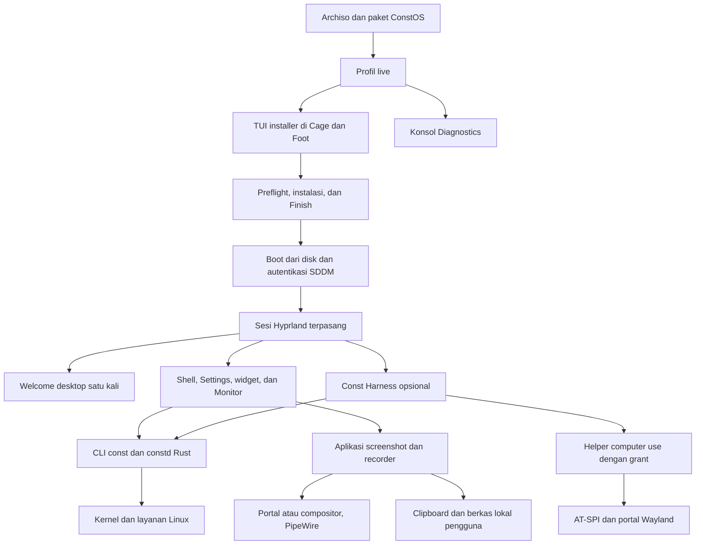

# Arsitektur ConstOS

ConstOS menargetkan desktop x86_64 UEFI berbasis CachyOS dengan Hyprland/Wayland. Desktop, installer, capture, dan diagnosis harus dapat digunakan tanpa akun AI, Harness, atau model lokal. Dukungan perangkat ditetapkan dari pengujian, bukan dari daftar paket.

Dokumen ini menjelaskan batas komponen dan arah desain. Status serta bukti penerimaan ada di [roadmap](../implementation_plan.md); cara membangun profil live ada di [panduan build](build-guide.md). Perubahan dokumentasi mengikuti [AGENTS.md](../AGENTS.md).

## Implementasi saat ini dan target

| Area | Implementasi saat ini | Target dan batas |
| --- | --- | --- |
| Build dan boot | Profil Archiso di `iso/`, kernel CachyOS BORE, tema GRUB/Plymouth/SDDM, dan `iso/install-boot.sh`. Roadmap mencatat bukti build baseline serta verifikasi integrasi terbaru. | CI Linux, pembuktian seluruh skenario Boot UI di VM baru, dan bukti perangkat fisik. BIOS, Secure Boot, dan varian kernel/CPU bukan dukungan implisit. |
| Sesi grafis | ISO men-stage TUI installer di Foot dan Cage. Pada target, `desktop/install.sh` memasang `constos.desktop` → `constos-session`, Lua Hyprland, layanan user, portal, dan asosiasi MIME. | Kiosk installer perlu dibuktikan pada ISO baru. Paket target menyediakan Dux Shell dengan preset Const. Uji fokus, multi-monitor, aksesibilitas, dan performa mengikuti gerbang desktop. |
| Screenshot dan media | `constos-screenshot` dipakai oleh Print, Alt+Print, Super+Shift+S, dan launcher. Escape membatalkan seleksi dan menjaga clipboard. | Toolbar, editor anotasi, serta perekaman audio dan video mengikuti [rencana capture](capture-plan.md). |
| Sistem dan storage | Konfigurasi ZRAM/sysctl, paket `constos-core`/`constos-desktop`, serta TUI dan backend Python untuk disk UEFI kosong. Baseline VM sebelumnya membuktikan Btrfs, reboot tanpa ISO, dan login SDDM. | Ulangi jalur utama pada build terbaru sesuai [spesifikasi installer](installer-plan.md). Uji recovery/rollback Snapper dari bootloader dan verifikasi perangkat fisik sebelum ConstOS 1.0. |
| Telemetri | CLI Rust `const` dan daemon Rust `constd` berbagi collector. Paket `constos-core` memiliki binary, unit systemd user, dan descriptor aktivasi D-Bus sesi. Staging live mengambil ketiganya dari arsip core yang lolos checksum. | Hubungkan Monitor dan widget ke snapshot sesi, lalu tetapkan kontrak stream serta kebijakan sampling saat konsumen membutuhkannya. |
| Harness dan sandbox | Resep paket Harness dan wrapper Bubblewrap tersedia. | Paket Linux lengkap, helper computer use sesi pengguna, izin per capability, dan sandbox teruji. Keberadaan wrapper bukan bukti seluruh workspace/desktop sudah terisolasi. |
| Aset | Master simbol Const dan ekspor historis ada di `assets/`. Boot dan greeter memakai teks, progres, dan bentuk QML. Tema berada di `desktop/`. | Audit hak logo, aset lain, dan penerimaan boot baru masih diperlukan; pemilihan logo bukan bukti lisensi redistribusi. |

## Alur target

Diagram ini adalah desain target, bukan inventaris layanan yang sudah berjalan.



## Tanggung jawab repositori

| Lokasi | Pemilik tanggung jawab |
| --- | --- |
| `iso/` | Profil Archiso, manifest live, GRUB, helper `install-boot.sh`, overlay, staging, dan pemanggilan `mkarchiso`. Artefak kerja/output bukan sumber konfigurasi. |
| `installer/` | Sumber TUI Ryoku yang diadaptasi, konfigurasi, manifest target, dan backend Python untuk disk UEFI kosong. |
| `desktop/` | Sumber sesi, keybind, tema boot/fallback, unit user, helper screenshot/lock, portal, dan MIME. Hanya file yang dipasang `desktop/install.sh` atau `iso/install-boot.sh` boleh disebut efektif. |
| `packages/` | Builder dan resep `constos-core`/`constos-desktop`, builder binary `constos-tui` khusus live, serta resep Harness. Paket Harness belum menyertakan binary upstream. |
| `assets/` | Aset visual sumber/ekspor yang dipakai, dengan provenance dan lisensi yang perlu dicatat. |
| `docs/` | Arsitektur dan panduan teknis; tidak menyalin backlog atau menyimpan bukti media mentah. |
| `tests/` | Runner build tercatat dan smoke Live UEFI; probe hanya berjalan pada VM uji, bukan service yang dikirim dalam ISO. |
| `crates/` | Sumber collector Rust, CLI `const` dalam crate `constosctl`, dan daemon `constd`. |
| `system/` | Lokasi yang direncanakan untuk kebijakan sistem. |

`iso/buildiso.sh` menjalankan `installer/install.sh` untuk sesi live. Paket `constos-desktop` menjalankan `desktop/install.sh` untuk sesi Hyprland, Welcome, dan entri launcher pada target. Keduanya memakai `iso/install-boot.sh` untuk tema boot/greeter bersama dan konfigurasi spesifik masing-masing. Entry Hyprland efektif berada di `desktop/hypr/hyprland.lua`.

`packages/build-installer.sh` mengompilasi TUI Go. `iso/buildiso.sh --installer-dir DIR` memeriksa checksum binary dan fingerprint sumber, lalu memasang TUI pada overlay live. Config pacman target berasal dari `installer/pacman.conf`. Binary TUI dan konfigurasi sudo live terpisah dari paket target.

## Batas proses dan kepercayaan

### Sistem lokal

Collector membaca data Linux sebagai pengguna biasa. CLI `const status --json` membaca satu snapshot langsung. Monitor, widget, dan Harness akan memakai kontrak metrik yang sama saat integrasinya dibuat.

`const doctor` bekerja sebagai proses baca-saja di akun pengguna pada target terpasang. Ia memakai collector untuk identitas kernel, `/proc/swaps` untuk swap aktif, dan `systemctl` untuk daftar unit sistem yang gagal. Pemeriksaan storage membaca ruang yang tersedia di `/` melalui `df`, metadata konfigurasi root Snapper, dan status mount `/.snapshots` dari `/proc/self/mountinfo`. Pemeriksaan tidak memerlukan daemon Rust, layanan jaringan, atau elevasi.

`const update` berjalan dari terminal interaktif di target terpasang. Setelah memeriksa identitas sistem dan penanda boot live, proses CLI menyerahkan terminal ke `sudo` dan `pacman -Syu`, sehingga status keluar diteruskan langsung. Otorisasi mengikuti kebijakan `sudo` pada target. Konfirmasi, lock transaksi, validasi paket, dan konfigurasi repo tetap milik pacman.

Aksi yang memerlukan elevasi tidak dicampur dengan pembacaan metrik. Gunakan method sempit, validasi parameter, otorisasi per operasi, serta hasil aktual. UI tidak menganggap perubahan sukses hanya karena request terkirim. Jangan menambahkan listener jaringan atau aturan polkit tanpa password untuk menyederhanakan integrasi.

### Telemetri sesi

D-Bus sesi mengaktifkan `constd.service` sebagai pengguna yang memiliki bus. Nama dan interface `org.constos.Monitor1` memakai objek `/org/constos/Monitor1`. `GetSnapshot` menerima nol argumen dan mengembalikan string JSON dari `const_collector::SystemSnapshot`, dengan kolom yang sama seperti `const status --json`. Versi kontrak ada pada nama interface. Unit berjalan selama bus tersedia atau sampai dihentikan oleh systemd. Klien mengambil snapshot sesuai kebutuhan. Streaming, cache, dan subscription mengikuti integrasi UI.

Cutover menghapus prototipe Python dan listener HTTP `127.0.0.1:9099`. Pencarian pada checkout sebelum migrasi menemukan rute prototipe dan referensi historis. Pemanggil eksternal yang pernah memakai HTTP perlu beralih ke D-Bus sesi. Snapshot membatasi informasi proses pada hitungan agregat.

```bash
busctl --user --json=short call org.constos.Monitor1 /org/constos/Monitor1 \
  org.constos.Monitor1 GetSnapshot
```

### Capture pengguna

Screenshot dan rekaman adalah aksi eksplisit pengguna desktop. Aplikasi yang sudah tersedia menangani capture/encoding; shell mengintegrasikan launcher, shortcut, preferensi, status, dan Stop. Hindari daemon capture custom sebelum ada kebutuhan yang tidak dapat dipenuhi backend yang diuji.

Pisahkan akses layar, mikrofon, audio sistem, dan berkas. Jalur portal mengikuti picker/consent backend; capture langsung dari compositor memiliki cakupan akses sesi yang berbeda dan harus dinyatakan demikian. Meng-crop gambar tidak mempersempit izin sumber yang sudah diterima.

Satu pemilik status menyinkronkan recorder, panel, dan notifikasi. Indikator aktif serta Stop tidak bergantung pada Island. Lock/logout/revoke melepaskan akses sumber; hasil baru dinyatakan selesai setelah finalisasi. Perilaku kegagalan, sumber hilang, format, dan playback mengikuti kontrak fase 07A.

Capture biasa tidak memberi izin computer use, tidak otomatis mengunggah hasil, dan tidak memasukkan frame/audio mentah ke log. Rekaman audio-only tidak meminta akses layar. Dukungan screen sharing aplikasi lain diuji terpisah dari perekaman berkas.

### Kompatibilitas aplikasi

Rancangan awal memakai manifest target untuk menyertakan Wine. Paket desktop terpasang memiliki handler MIME dan alur konfirmasi. Wine dan installer aplikasi berjalan sebagai pengguna biasa pada sesi Hyprland. Prefix dan shortcut terkelola dimiliki pengguna. Prefix terpisah membatasi benturan konfigurasi antar aplikasi, sedangkan akses berkas tetap mengikuti izin akun Linux.

Untuk Android, pilihan pada installer menyiapkan paket dan image Waydroid. Unit sistem upstream memiliki lifecycle container. Sesi grafis pengguna memiliki interaksi pemasangan APK serta peluncuran aplikasi. Penyiapan sistem terpisah dari eksekusi file yang dipilih pengguna. Rincian paket, state, dan kriteria penerimaan ada di [rancangan kompatibilitas aplikasi](app-compatibility.md).

### Installer otomatis dan pengenalan desktop

Entri GRUB **Install Tsukuyomi** memulai SDDM dengan autologin khusus `liveuser`. Sesi menjalankan Cage pada satu output dan membuka TUI di Foot. Jika layout keyboard berubah, sesi membuka ulang Cage dengan layout baru sebelum pengisian akun. Saat TUI keluar, kiosk menawarkan buka ulang, reboot, atau matikan. Entri **Tsukuyomi Diagnostics** memakai `multi-user.target` dan membuka TTY.

Backend mengembalikan daftar disk layak melalui `--list-disks`. Setelah Review, TUI mengirim satu dokumen JSON melalui stdin ke backend yang berjalan lewat sudo. Payload berisi identitas disk yang dipilih, ID browser, konfigurasi wilayah dan akun, serta hash kata sandi SHA-512 crypt. Backend membaca ulang disk dan memvalidasi pilihan sebelum unduhan, lalu memeriksa ulang disk serta arsip sebelum partisi. Backend mengeluarkan event `@@CONST_STEP` untuk progres. TUI hanya menampilkan layar selesai sesudah proses keluar sukses dan unmount selesai.

Akun target dibuat dengan Fish dan akses sudo melalui grup wheel, sementara root dikunci. SDDM di target memakai Clockwork Orbital untuk autentikasi sebelum Hyprland dimulai. Halaman Network memakai NetworkManager dan halaman Browser menentukan paket serta handler target. [Spesifikasi installer](installer-plan.md)

Paket `constos-desktop` memasang panduan shortcut Quickshell/QML yang mengadaptasi `PageEssentials`, `ActionKey`, `PageTitle`, dan `Keycap` Ryoku. `guide.py` mengawasi proses, mengunci satu instance per akun, dan menyimpan `$XDG_STATE_HOME/constos/welcome-seen` hanya setelah penutupan normal. Service sesi memeriksa penanda pada login pertama; launcher bisa membuka ulang. Panduan tidak memuat gambar dan tidak memerlukan daemon, Hub, atau Store Ryoku. Recommended Apps tetap menjadi aplikasi GTK terpisah dengan katalog Flatpak yang sama.

SDDM memanggil `constos-session` → `start-hyprland --` → Hyprland. Watchdog resmi memiliki proses compositor; wrapper tetap memiliki lock dan cleanup layanan sesi setelah watchdog berhenti. Dux Shell resmi menjalankan bar, launcher, Settings, lock, dan notifikasi; preset vendor Tsukuyomi tidak mengganti kode paket Dux. Fastfetch membaca turunan ASCII Const dari `/usr/share/constos/desktop/const.txt` khusus terminal.

Default Hyprland untuk akun baru memakai Dwindle. Hyprland menangani fokus, fullscreen, dan perpindahan tile. Shortcut overview memanggil IPC Dux, dan shortcut browser meluncurkan Desktop Entry default sesi. [Daftar shortcut](desktop-shortcuts.md)

Konfigurasi target GRUB memakai `GRUB_DISABLE_BOOTNEXT=true` untuk meniadakan daftar perangkat EFI tambahan. Generator kernel, submenu advanced/recovery, dan pengaturan firmware tetap berjalan. Installer menampilkan sebab kegagalan, tahap, dan path log privat. Retry otomatis hanya tersedia sebelum event storage; disk yang sudah memasuki storage harus diperiksa terlebih dahulu.
Katalog memakai ID aplikasi tetap. Tombol **Install** menyiapkan remote dari descriptor Flathub yang disertakan paket Flatpak bila belum ada, lalu memasang ref untuk pengguna aktif. Remote dengan URL berbeda, dinonaktifkan, atau tanpa verifikasi GPG ditolak. UI menampilkan sukses setelah Flatpak mengonfirmasi ref. Inventaris saat ini masih membaca ID lintas scope dan perlu diselaraskan dengan aksi.

**Const Store** dirancang sebagai pemilik discovery, Library, dan transaksi aplikasi pilihan dari Flathub. Recommended Apps memakai katalog yang sama. Backend membawa scope, origin, dan ref saat membaca dan mengubah status, lalu memuat ulang state setelah hasil transaksi. Pembaruan OS dan paket vendor tetap melalui pacman. Const Hub mengatur preferensi aplikasi dan desktop.

### Harness dan computer use

Harness adalah aplikasi opsional dengan update melalui pacman untuk edisi distro. Helper berjalan sebagai user-session child melalui inherited stdio. Pilihan Rust adalah arah implementasi; adapter upstream harus tetap mematuhi handshake dan batas kemampuan yang tervalidasi.

Grant sementara memisahkan observasi semantik, visual capture, dan pengiriman input. Periksa target, sesi, capability, expiry, serta pembatalan pada setiap aksi. Portal/AT-SPI/compositor adalah batas kemampuan nyata: jangan menawarkan kontrol global bila scope dan consent tidak dapat ditegakkan. Stop, lock, logout, revoke, atau putusnya induk menutup akses terkait. Pengiriman data ke model eksternal perlu izin terpisah.

Sandbox terminal terpisah dari izin desktop. Jangan memberi workspace sandbox socket helper, descriptor portal, keyring, atau akses input global secara otomatis. `/dev/input`, `/dev/uinput`, kontrol root, dan sesi remote/unattended berada di luar jalur computer use rilis awal. Ollama/model lokal bukan dependensi desktop atau isi wajib ISO.

Pembuatan widget lewat Harness memakai jalur draft terpisah dari computer use. Widget host memvalidasi schema versi, tipe komponen, sumber data, dan batas sumber daya. Draft hanya memakai daftar komponen dan binding yang disediakan ConstOS. Shell menampilkan preview dan menyimpan instance ke profil setelah persetujuan pengguna. Draft tidak membawa kode QML/JS, perintah shell, kredensial, atau grant observasi/input.

## UI, widget, dan aset

UI memakai token visual bersama, aksi bertipe, dan state aktual. Provider memiliki subscription/event serta kebijakan sampling; shell, Monitor, dan widget tidak memindai metrik yang sama secara independen. Error provider harus menjadi state lokal, bukan menjatuhkan shell.

Rancangan desktop memisahkan shell yang hidup selama sesi dari **Const Hub**, aplikasi Settings yang dibuka sesuai kebutuhan. Quick Settings dan Hub memakai provider yang sama. Dock aplikasi dan Island menjadi surface terpisah dengan konfigurasi independen. Launcher dan pintasan sesi tetap berfungsi tanpa keduanya. Cutover setiap surface menjaga satu pemilik fokus, input mask, dan reservasi per tepi/output.

Arah visual dan kontrak interaksi tema ada di [design.md](../design.md); pemilih aksen dan generator palet belum diimplementasikan. Targetnya satu pemilik preferensi Appearance dan satu hasil generasi token per sesi, bukan ekstraktor wallpaper terpisah pada tiap widget/toolkit. Default token vendor dimiliki paket desktop; pilihan mode Default/Manual/Wallpaper dan wallpaper sumber disimpan per pengguna. Settings meminta preview/apply/cancel pada pemilik state yang sama; adapter toolkit melaporkan penerapan atau kegagalan aktual. Token turunan adalah hasil generasi, bukan sumber preferensi kedua. Versi schema, algoritme, path, dan transport konkret ditetapkan saat implementasi.

Ekstraksi wallpaper berjalan lokal sebagai user biasa; kegagalan mempertahankan palet terakhir yang valid dengan status error. Boot/initramfs dan greeter memakai ekspor vendor statis tanpa membaca wallpaper atau home pengguna. Tema adaptif tidak memberikan izin capture maupun computer use dan tidak memperluas akses berkas ke pengguna lain.

Widget bawaan memiliki ID jenis/instance, schema preferensi, sumber data, aksi terbatas, dan lifecycle. Layout per-user dimigrasikan ketika upgrade atau output berubah. Plugin pihak ketiga tidak termasuk dukungan 1.0 sebelum model izin/kompatibilitas/isolasinya ditetapkan. Aksesibilitas QML, fokus, dan keyboard diuji sebelum toolkit dikunci.

Kitty memakai Fish sebagai login shell akun baru. Fastfetch membaca simbol Const ASCII dari paket desktop. Pengaturan pengguna berada di XDG config; default di `/etc/skel` berlaku saat akun dibuat.

`constos-shell.service` menjalankan Dux untuk bar, launcher, notifikasi, lock, idle, wallpaper, dan polkit sesi. Dux membaca preset Const dari konfigurasi akun dan palet vendor dari `/usr/share/constos/desktop`. Shell memakai UI bawaan paket resmi `extra/dux-shell` melalui `dms run --session`. Saat membuat akun pertama, installer mengisi penanda seri rilis Dux di `/etc/skel` agar layar pembuka desktop memakai panduan shortcut Tsukuyomi. Wofi dipanggil sebagai cadangan saat perintah launcher Dux gagal.

`assets/manifest.json` mencatat asal dan pemakaian aset. Tema GRUB, Plymouth, dan QML Clockwork Orbital memakai kode Ryoku dengan palet Const. Tema bawaan memakai teks dan elemen fungsional tanpa logo.

## Konfigurasi, state, dan lifecycle sesi

- Paket memiliki default vendor; preferensi pengguna mengikuti XDG config, data persisten mengikuti XDG data, state mengikuti XDG state, dan resource sementara mengikuti runtime directory sesi. Path serta schema konkret ditetapkan bersama implementasinya.
- Tulis preferensi secara atomik, versikan schema, dan migrasikan tanpa menimpa pilihan pengguna. Seeder hanya membuat konfigurasi awal yang belum ada.
- Sesi grafis diluncurkan melalui `constos-session`, lalu `constos-session-start` mengimpor `WAYLAND_DISPLAY` aktual dan mengaktifkan `constos-session.target`. Saat logout, layanan desktop dan portal dihentikan serta environment Wayland dibersihkan agar login berikutnya tidak menggandakan panel, applet, atau daemon notifikasi.
- Backend installer hanya berjalan dari ISO live UEFI. Preflight memeriksa waktu/keyring lalu mengunduh transaksi bertanda tangan dan menyimpan daftar arsip beserta hash sebelum partisi. Storage memeriksa ulang identitas disk serta hash arsip; bootstrap memakai `pacstrap -U` dari arsip tepat tersebut, tanpa sinkronisasi repo ulang. Target dibangun dari transaksi itu dan paket lokal ber-checksum, bukan overlay live. Symlink `os-release` upstream yang dikenal dan belum dimiliki paket dilepas sebelum pemasangan core, lalu identitas target divalidasi.
- Gunakan direktori media XDG untuk hasil capture sesuai pilihan pengguna. Jangan menyimpan rekaman atau rahasia di direktori runtime yang bisa hilang saat logout.
- Satu pemilik per service sesi, notification bus name, dan reservasi tepi layar. Jangan menjalankan dua panel/daemon setelah login ulang atau selama cutover.
- Impor environment dari sesi aktif; jangan hardcode nama display Wayland. Lock/logout harus memberi jalur penghentian akses capture dan computer use yang dapat diuji.
- Akun live, autologin, sudo khusus ISO, dan repositori sementara tidak diwariskan ke sistem terpasang. Recovery harus tetap bisa dijalankan melalui TTY ketika shell atau greeter gagal.

## Keputusan yang belum dikunci

Toolkit shell/Settings, backend screenshot/editor/recorder, format/codec, transport/schema IPC final, layout storage yang didukung, preset performa, dan matrix hardware memerlukan hasil spike atau pengujian. Catat keputusan, alternatif yang ditolak, konsekuensi, versi, dan bukti pada bagian arsitektur yang terdampak; roadmap menyimpan langkah serta gerbang penerimaannya.
